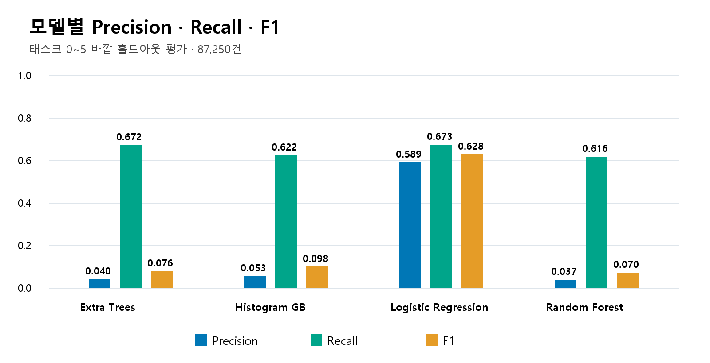
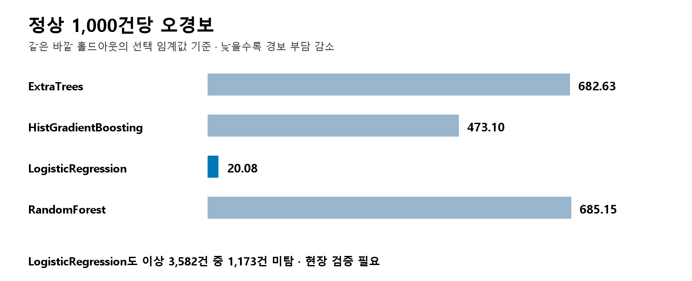

## 5. 모델 성능 Benchmark

다음은 보존된 4차 comparison.csv의 nested_selected 결과이다. 이번 패키징 과정에서 재학습한 결과가 아니다.

| 모델 | Precision | Recall | F1 | 오경보/정상 1,000건 |
| --- | ---: | ---: | ---: | ---: |
| ExtraTrees | 0.0404 | 0.6717 | 0.0763 | 682.63 |
| HistGradientBoosting | 0.0533 | 0.6220 | 0.0982 | 473.10 |
| LogisticRegression | 0.5891 | 0.6725 | 0.6281 | 20.08 |
| RandomForest | 0.0371 | 0.6161 | 0.0699 | 685.15 |

LogisticRegression은 비교 모델 중 가장 높은 F1과 가장 적은 오경보를 보였다. 그러나 이상 3,582건 중 1,173건을 놓쳤고 Recall 0.6725는 목표 0.70에 미치지 못했다. 태스크 5에서는 정상 1,000건당 오경보가 242.57건으로 증가했다.

주의 cutoff를 적용하면 Recall 0.8908로 높아지지만 정상 1,000건당 오경보도 272.98건으로 늘었다. 미탐 감소와 경보 처리 부담의 균형을 검토해야 한다.

