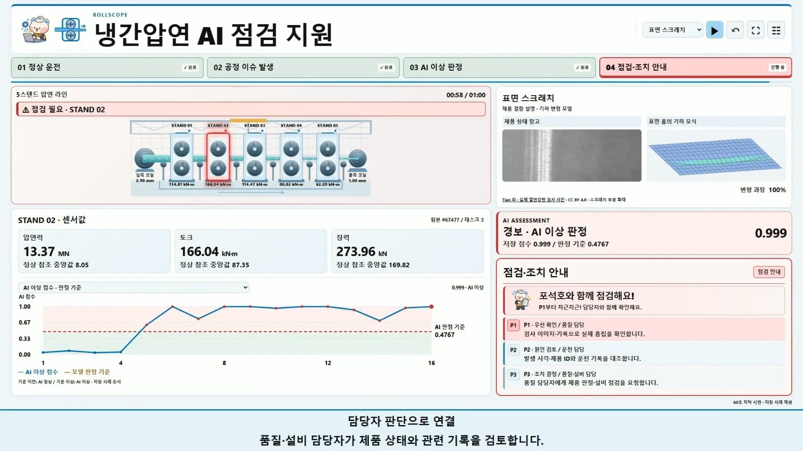
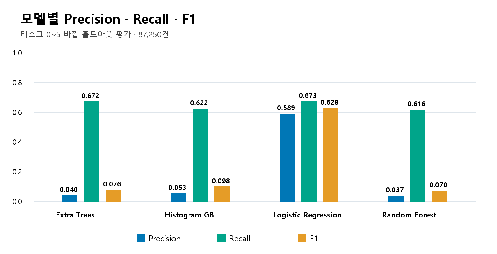
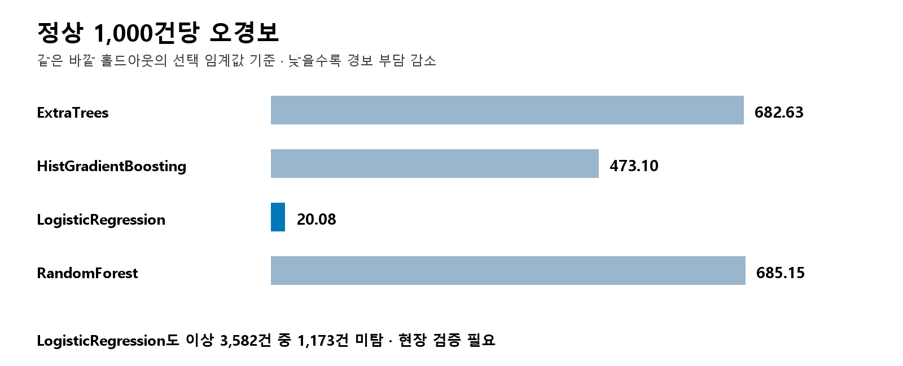

# 결과보고서

**ROLLSCOPE 냉간압연 AI 이상 탐지 및 점검 지원**

팀 일단 해보죠 · 포스코 K-뉴딜 해커톤 · 2026년 11월 9일

## 1. 문제정의

냉간압연 공정은 여러 스탠드의 압연력·토크·장력 등 복수 변수를 함께 확인해야 한다. 본 프로젝트는 센서 변화와 AI 판정을 담당자의 점검 순서로 연결하는 ROLLSCOPE 프로토타입을 개발했다.

목표는 센서 수치, AI 이상 점수, 5스탠드 시각화, 제품 상태 참고 이미지와 점검 안내를 한 화면에서 이해하도록 하는 것이다. 실제 설비 자동 제어와 생산 품질 개선 효과까지 검증한 것은 아니다.

센서 정상 분포 P5~P95는 참고 구간이며 설비 안전 한계가 아니다. 최종 시연은 AI 점수 그래프에 모델 판정선을 표시하고 센서 그래프는 변화 확인용으로 구분한다.

## 2. 데이터

CAD-TCM은 물리 시뮬레이션 기반 공개 합성 데이터이다. 원본 CSV는 108,872행, 정상 104,096건과 이상 4,776건으로 구성된다. 51개 공정 변수를 사용하며 비교 실험에는 36변수 구성도 포함했다.

| 태스크 | 정상 | 이상 |
| --- | ---: | ---: |
| 0 | 9,873 | 597 |
| 1 | 27,878 | 597 |
| 2 | 4,787 | 597 |
| 3 | 23,100 | 597 |
| 4 | 12,650 | 597 |
| 5 | 5,380 | 597 |
| 6 | 14,005 | 597 |
| 7 | 6,423 | 597 |

개발 태스크 0~5는 87,250행이며, 태스크 6~7은 이전에 평가한 데이터이므로 신규 독립 외부 시험으로 해석하지 않았다. 공식 지속학습 벤치마크와 달리 개발 태스크의 제공 이상 라벨을 활용한 별도 지도학습 설정이다.

실제 코일·설비·연속 시각 식별자는 없다. 시연은 정상 4건과 이상 12건을 선별해 원본 값과 점수를 유지하면서 순서대로 표시한다. 실제 운전 시간이나 조치 후 회복을 재현한 시계열은 아니다. 제품 표면 사진은 해당 센서 사례에 직접 연결된 검사 결과가 아닌 참고 자료이다.

## 3. 모델

RandomForest, ExtraTrees, HistGradientBoosting, LogisticRegression 네 알고리즘에서 각각 두 설정을 비교했다. label·task_id·task_name·task_split은 입력 특징에서 제외했다. LogisticRegression에는 학습 폴드의 결측값 중앙값 대체와 표준화를 적용했다.

개발 태스크를 바깥 홀드아웃 [0,3], [1,4], [2,5]로 나누고 각 학습 구간 안에서 GroupKFold 3분할 OOF로 설정과 임계값을 선택했다. 같은 태스크가 해당 학습과 검증에 동시에 포함되지 않도록 구성했다.

내부 Recall 0.70 이상을 만족하는 가장 높은 cutoff를 선택했다. 바깥 테스트 라벨은 이 선택에 사용하지 않았다. LogisticRegression의 최종 개발 OOF cutoff 약 0.4122와 시연용 바깥 폴드의 0.476708873137658은 서로 다른 학습·선택 구간의 값이다.

기본 분석 앱은 기존 RF를 유지하고 연구 후보를 선택할 수 있다. HTML은 저장된 LogisticRegression 점수를 표시하며 브라우저에서 모델을 새로 추론하지 않는다.

## 4. 시스템 구현

| 기능 | 구현 내용 |
| --- | --- |
| 데이터 입력 | CSV 검증, 실패 시 예측·저장 차단 |
| 공정 분석 | 5스탠드 센서값과 정상 분포 비교 |
| 모델 비교 | 알고리즘별 성능, 태스크별 오경보·미탐 |
| 점검 관리 | 원본 레코드, 모델 버전, 임계값, 점검 메모 기록 |
| 시연 | 정상 운전 → 공정 이슈 → AI 이상 판정 → 점검 안내 |
| 우선순위 | P1 제품 확인 → P2 운전 데이터 대조 → P3 담당자 검토 |

HTML에는 단계별 색상과 빨간 알람, 한 점씩 나타나는 그래프, 포석호 안내를 적용했다. 공정의 강조 위치는 설명 시나리오이며 실제 고장 위치를 확정한 모델 결과가 아니다. 기하 모식은 설명용 변형이며 FEM 수치해석 결과가 아니다.

제목과 필요성 소개 뒤 대시보드로 이어지는 한국어 내레이션 영상도 제작했다. 이번 핵심 코드 공유본에는 영상·발표자료 파일을 포함하지 않았다.

## 5. 모델 성능 Benchmark

다음은 보존된 4차 comparison.csv의 nested_selected 결과이다. 이번 패키징 과정에서 재학습한 결과가 아니다.

| 모델 | Precision | Recall | F1 | 오경보/정상 1,000건 |
| --- | ---: | ---: | ---: | ---: |
| ExtraTrees | 0.0404 | 0.6717 | 0.0763 | 682.63 |
| HistGradientBoosting | 0.0533 | 0.6220 | 0.0982 | 473.10 |
| LogisticRegression | 0.5891 | 0.6725 | 0.6281 | 20.08 |
| RandomForest | 0.0371 | 0.6161 | 0.0699 | 685.15 |

LogisticRegression은 비교 모델 중 가장 높은 F1과 가장 적은 오경보를 보였다. 그러나 이상 3,582건 중 1,173건을 놓쳤고 Recall 0.6725는 목표 0.70에 미치지 못했다. 태스크 5에서는 정상 1,000건당 오경보가 242.57건으로 증가했다.

주의 cutoff를 적용하면 Recall 0.8908로 높아지지만 정상 1,000건당 오경보도 272.98건으로 늘었다. 미탐 감소와 경보 처리 부담의 균형을 검토해야 한다.

## 6. DB와 점검 이력

분석 앱은 SQLite에 원본 레코드, 입력 파일 해시, 모델 파일 버전, 특징 구성, 당시 임계값, 위험도 정책과 점검 메모를 저장한다. 기존 DB는 백업 후 컬럼을 추가하는 방식으로 확장한다.

이력 조회·점검 수정·CSV 전체 이력 내보내기·PDF 최신 200건 내보내기를 제공한다. 사용자 인증·변경 감사 이력·다중 사용자 충돌 관리 기능은 구현 범위에 포함하지 않았다. HTML의 사례 저장은 Python 앱의 영구 DB와 구분된다.

실제 PLC·MES·센서 스트리밍과 연결하지 않았으며, 화면에 점검 안내가 나타나는 것이 설비 조치 완료를 의미하지 않는다.

## 7. 검증 결과

기존 4차 전달 자료에는 자동 테스트 49건 통과 기록이 있다. 모델·전처리·폴드 분리·CSV 실패 차단·DB 확장·내보내기 등이 포함됐다. 이 기록은 원래 프로젝트 검증이며 이번 경량 공유본 전체를 새로 실행한 결과가 아니다.

시연 화면은 1920×1080, 1536×864, 1366×768의 네 시점씩 확인한 기존 기록에서 overflow와 clipped 항목이 없었다. 영상은 Chrome에서 2·12·61초 디코딩과 오디오 트랙을 확인했다.

이번 공유본에는 외부 평가 파일에 의존하지 않는 핵심 파이프라인 테스트만 남겼다. Python 구문, 내부 모듈 경로, 문서 링크와 압축 무결성을 확인한다. 새 PC 전체 설치·학습과 장시간 운전, 실제 센서 통신 실패 복구는 별도 검증이 필요하다.

## 8. 한계와 개선 방향

| 우선순위 | 항목 | 후속 과제 |
| --- | --- | --- |
| 1 | 현장 데이터 | 시간·코일 ID·강종·검사 결과를 센서와 연결 |
| 2 | 독립 평가 | 새 운전 조건에서 Precision·Recall·오경보·미탐 확인 |
| 3 | 경보 정책 | 허용 경보 부담, 지속 조건, 해제 기준을 담당자와 설정 |
| 4 | 점검 검증 | AI 경보를 실제 점검 결과와 연결해 유효성 검증 |
| 5 | 운영 안정성 | 실시간 수집·추론 지연, 통신 장애·복구 시험 |
| 6 | 관리 기능 | 권한·수정 감사·동시 편집·백업 복구 추가 |

생산 불량률, 정지 시간, 에너지와 점검 시간의 절감 효과는 현장에서 측정하지 않았다. 연구용 점수를 실제 고장 확률이나 안전 등급으로 해석하지 않는다.

## 9. 결론

냉간압연 데이터를 AI 이상 판정, 공정 시각화, 점검 우선순위와 이력 관리로 연결했다. LogisticRegression은 비교 실험에서 F1 0.6281을 보였지만 미탐과 태스크별 성능 차이가 남았다. 이번 성과는 점검 의사결정 지원 프로토타입의 구현이며 현장 적용에는 실제 데이터 연계와 독립 검증이 필요하다.

## 근거 자료

- [원본 모델 비교 CSV](../03_모델평가/근거자료/comparison.csv)
- [태스크별 평가 CSV](../03_모델평가/근거자료/task_metrics.csv)
- [기존 테스트 로그](../03_모델평가/근거자료/tests.log)
- [외부 자산 출처](../THIRD_PARTY_NOTICES.md)
